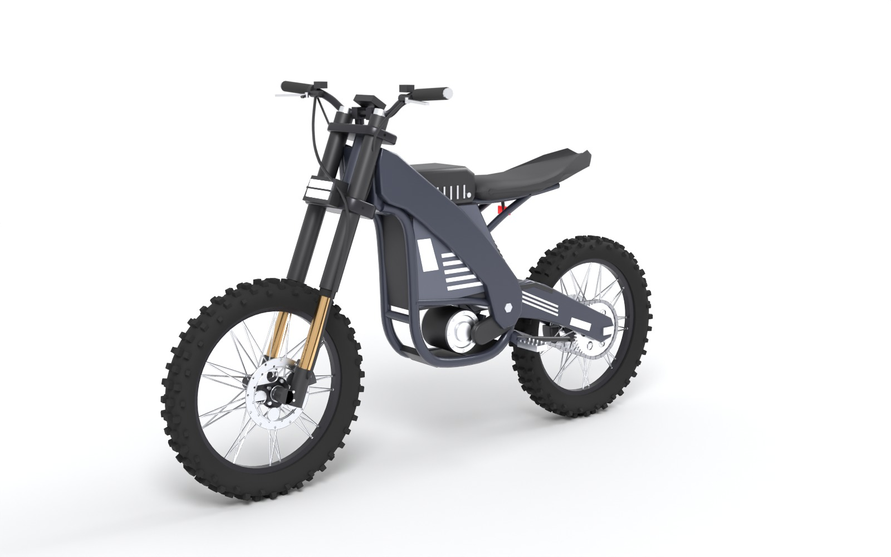
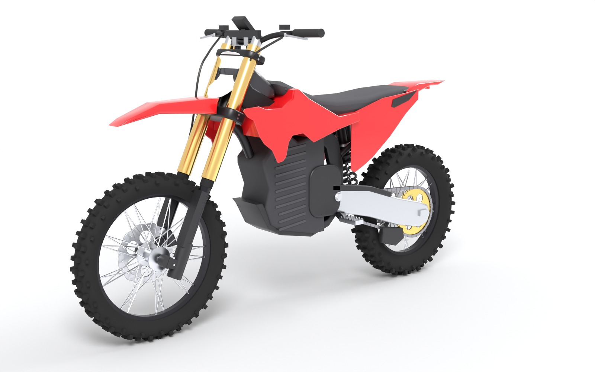

# E-bike game: bike models

Two detailed electric dirt-bike models for a Roblox game, built in Blender from
side-view reference photos:

| Model | Style | Real-world size | Files |
|---|---|---|---|
| `SurRon` | Light electric dirt bike, Sur-Ron Light Bee X style | 1.25 m wheelbase, 19" wheels | `models/SurRon.blend` / `.fbx` / `.glb` |
| `Varg` | Full-size electric motocross bike, Stark Varg MX style | 1.48 m wheelbase, 21"/19" wheels | `models/Varg.blend` / `.fbx` / `.glb` |




More angles are in [`renders/`](renders/).

Each model includes:

- **Wheels:** knobby tyres with chamfered tread blocks, laced spokes with
  nipples, valve stems, drilled or wave brake rotors and calipers.
- **Front end:** upside-down forks with adjusters and triple clamps.
- **Controls:** handlebars with curved levers, hydraulic master cylinders,
  grips, switchgear and a dash display.
- **Rear end:** a coil-over shock with reservoir, a swingarm with chain
  adjusters and a chain guide, and a roller chain with sprockets.
- **Frame and bodywork:** forged frame plates with bolts, cables and hoses, the
  battery and motor, and smooth curved seats, fenders and bodywork.

Brand logos and names are intentionally left off, because Roblox moderates
trademarked logos.

Surface textures in the renders (grippy seat, rubber, brushed aluminium,
paint, dust and edge highlights) are procedural Blender shaders. They don't
carry over into Roblox, where parts get flat colours from `BikeColors.lua`.

The preview renders place the bike in a real photographed environment, a
public-domain HDRI of a Venetian square from Poly Haven
(`blender/assets/`, see its README), with a shadow-catcher floor.

## How the models are organised

Every bike is split into five moving groups, and each group into one mesh per
material. Meshes are named `<Bike>_<Group>_<material>`, for example
`SurRon_FrontWheel_rubber`.

| Group | Contents | Mesh origin (pivot) |
|---|---|---|
| `Body` | frame, battery, motor, seat, bodywork, shock, pegs | bike centre |
| `Steering` | forks, clamps, handlebar, headlight/number plate, front fender, front caliper | steering head |
| `FrontWheel` | tyre, rim, spokes, hub, front rotor | front axle |
| `Swingarm` | swingarm, chain, rear caliper | swingarm pivot |
| `RearWheel` | tyre, rim, spokes, hub, rear rotor, sprocket | rear axle |

Every mesh is under Roblox's 20,000-triangle limit. Larger ones are split into
numbered pieces (`SurRon_Body_frame`, `SurRon_Body_frame2`, ...). `models/<Bike>_rig.json`
lists each mesh's pivot and triangle count, plus the axle centres, the steering
axis and the swingarm pivot. Use these points to place `HingeConstraint`s for the
wheels and steering and a hinge or spring for the swingarm. Coordinates in that
file are Blender metres: +X is the bike's left, -Y is the front, +Z is up, and
the ground is at Z = 0.

## Importing into Roblox Studio

1. In Studio, open **Import 3D** (Home or Avatar tab) and choose
   `models/SurRon.fbx` or `models/Varg.fbx`.
2. The files are in real-world metres. If the bike comes in at the wrong size,
   change the importer's file-dimensions or scale setting. Most games scale
   vehicles up a little to suit Roblox avatars.
3. The FBX export is set up so the bike's front should point along Roblox's
   forward (-Z) axis. If it imports facing backwards, rotate the model 180°.
4. Plain material colours don't always survive the import. Add
   `roblox/BikeColors.lua` as a ModuleScript and run it once on the imported
   model:

   ```lua
   local BikeColors = require(game.ServerScriptService.BikeColors)
   BikeColors.apply(workspace.SurRon)
   ```

## Riding the bike in Roblox

`roblox/RideKit.rbxmx` is a drop-in folder of scripts that makes the Sur-Ron
Roblox model (`surron1.rbxm`) rideable. It adds suspension, steering, lean,
wheelies, spinning wheels and an R6 riding animation done in code. See
[`roblox/RideKit/README.md`](roblox/RideKit/README.md) for setup and controls.

## Rebuilding or changing the models

The models are generated by Python scripts in `blender/`, so changes are
repeatable:

- `blender/bikekit.py`: shared modelling toolkit (tyres, wheels, rotors,
  sprockets, chain, springs, traced body panels, export and render helpers).
- `blender/surron.py`, `blender/varg.py`: one script per bike. The outlines
  are pixel coordinates measured from the reference photos and converted to
  metres with each bike's published wheelbase.
- `blender/build.py`: builds the bikes, saves the `.blend` files, exports FBX
  and GLB, writes the rig JSON, regenerates `roblox/BikeColors.lua` and renders
  the previews.

With Blender 4.0 or newer (tested with 4.0.2 and 5.3):

```bash
blender --background --python blender/build.py -- surron varg
```

Or with the `bpy` Python module (`pip install bpy`, Python 3.13 for bpy 5.x):

```bash
python blender/build.py surron varg
```

Useful flags: `--no-render` skips the preview renders, and `--samples 128`
gives cleaner renders.
